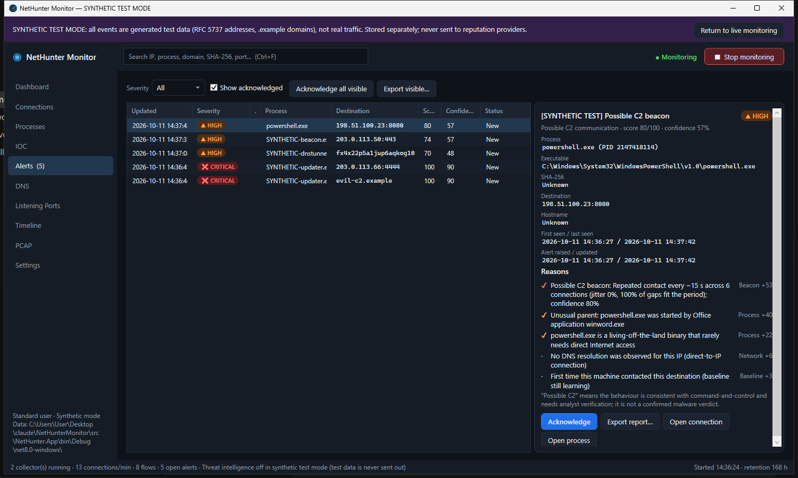
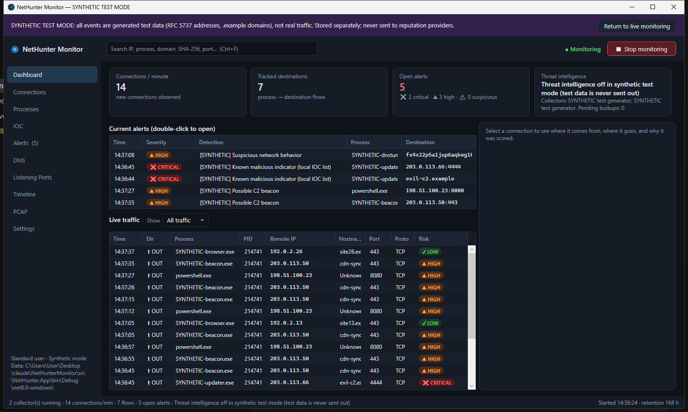
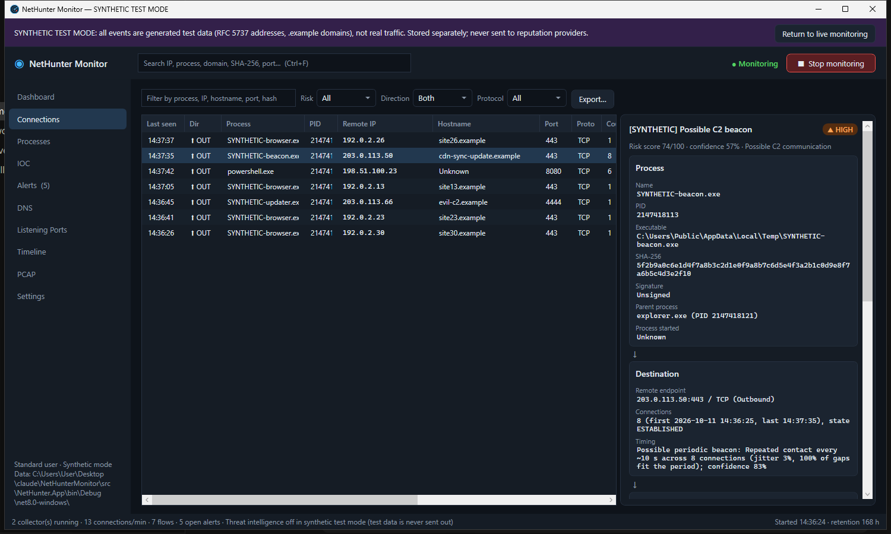
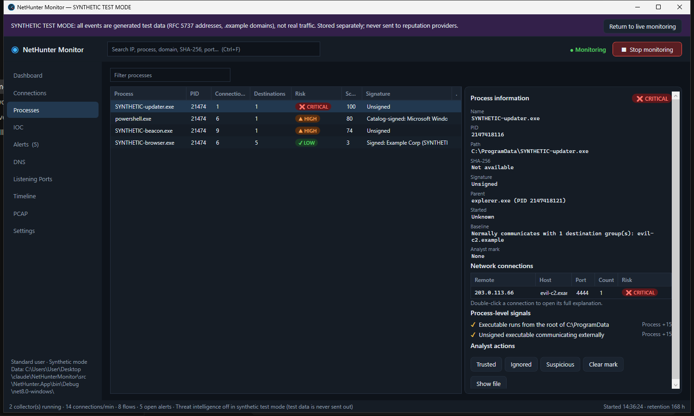
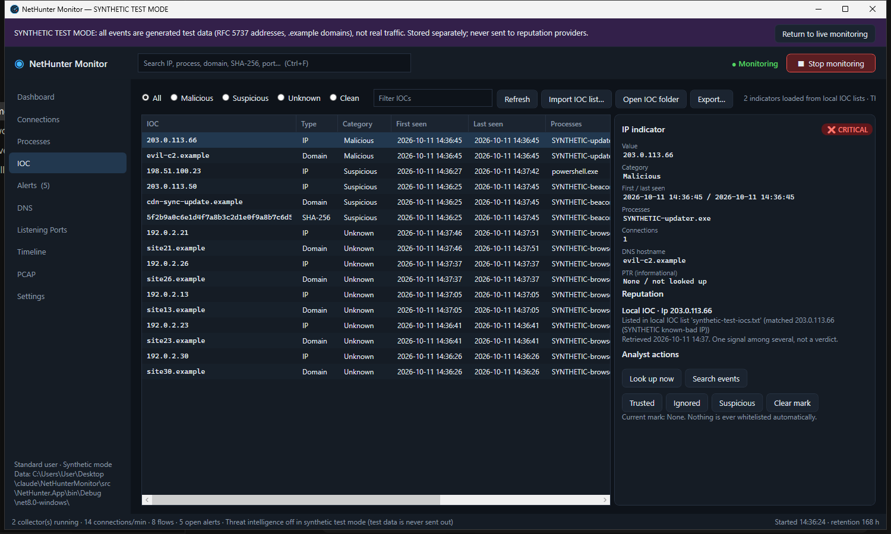

# NetHunter Monitor

A portable Windows network-monitoring and IOC-detection tool for finding **possibly compromised machines and possible
command-and-control (C2) traffic**. It shows every connection with the process behind it, the executable's SHA-256 and
signature, the destination's hostname and reputation, analyses behaviour (beaconing, DNS tunnelling, rare destinations,
LOLBins, masquerading…) and **explains every alert**.



* **Process → PID → executable → SHA-256 → destination → port → hostname → reputation → risk**, for every connection.
* **Explainable scoring**: risk score, confidence and the list of reasons; *IOC match*, *suspicious behaviour*,
  *possible C2* and *known malicious* are kept distinct. Nothing is called malware because it uses port 443, a cloud
  provider, has no PTR, or is unknown to VirusTotal.
* **Beacon detection** with jitter and missed-beat tolerance ("Possible C2 beacon, interval ≈ 60 s, confidence 87 %").
* **Threat intelligence**: your own IOC lists (offline, checked first), AbuseIPDB and VirusTotal (hash lookups only by
  default), with rate limiting, priority queues and persistent caching. Works fully offline without them.
* **VirusTotal and AbuseIPDB columns** in the Dashboard, Connections, Processes, IOC, Alerts and Timeline grids: detections (e.g. `8/95`) and abuse confidence (e.g. `92% · 34` reports) at a glance, colour-coded, with details on hover.
* **Portable**: one self-contained `NetHunterMonitor.exe` (no installer, no .NET runtime, no driver). Data stays next
  to the exe; delete the folder to remove it.
* **Least privilege**: runs as a standard user and says exactly what administrator rights would add.

Pages: Dashboard · Connections · Processes · IOC · Alerts · DNS · Listening Ports · Timeline · PCAP · Settings, plus a
global search box (IP, process, domain, SHA-256, port) and CSV / JSON / HTML report exports.

| | |
|---|---|
|  |  |
|  |  |

*(Screenshots are from the built-in synthetic test mode: documentation IP ranges and `.example` domains, not real traffic.)*

## Quick start

1. Download `NetHunterMonitor-<version>-win-x64-portable.zip` from **Releases** and extract it (e.g. `C:\Tools\NetHunterMonitor\`).
2. Run `NetHunterMonitor.exe`. Monitoring starts immediately; use **Stop/Start monitoring** in the top bar.
3. Optional: **Settings → Threat intelligence providers** to add AbuseIPDB / VirusTotal API keys
   (see [docs/API-PROVIDERS.md](docs/API-PROVIDERS.md)).
4. Optional: put your IOC lists in `config\ioc\` or use **IOC → Import IOC list…**.
5. Want to see detections without malware? **Settings → Restart in synthetic test mode**, or open
   `samples\synthetic-beacon-sample.pcap` on the **PCAP** page.

Requirements: Windows 10 or 11, x64. Nothing else.

### Standard user vs administrator

| Capability | Standard user | Administrator (*Restart as administrator*) |
|---|---|---|
| TCP connections with owning process | ✓ polled every 1 s | ✓ real-time (ETW) + polling |
| Very short-lived connections | partly (shown as *Process: Unknown* when only the TIME_WAIT remnant is seen) | ✓ |
| UDP peers with process | — | ✓ |
| DNS hostnames | ✓ from the Windows DNS cache | ✓ every query, with requesting process |
| Path / hash / signature of SYSTEM processes | — (name + PID shown) | ✓ |
| IOC lists, reputation, beaconing, baseline, alerts, listening ports, PCAP, export | ✓ | ✓ |

## Command line

`nethunter.exe` (included) runs the same engine headless:

```text
nethunter status                  privileges and available collectors
nethunter snapshot                current connections with process, path, SHA-256, signature
nethunter listeners               listening ports with owning process
nethunter dns-cache               current DNS cache entries
nethunter watch 120               live detection pipeline for 120 s, printing alerts with reasons
nethunter synthetic               run the synthetic detection scenario (offline, instant)
nethunter pcap capture.pcapng     analyse a capture with the same pipeline
nethunter check 185.220.101.1     local IOC + cached reputation for an IP, domain or hash
nethunter hash C:\path\file.exe   SHA-256 + Authenticode
nethunter make-sample-pcap x.pcap write a synthetic sample capture
```

## Build from source

Requires the [.NET 8 SDK](https://dotnet.microsoft.com/download/dotnet/8.0) on Windows.

```powershell
dotnet test NetHunterMonitor.sln                                     # 119 tests
powershell -ExecutionPolicy Bypass -File .\build.ps1                 # tests + portable zip in dist\
dotnet run --project src\NetHunter.App                               # run from source
```

## Documentation

* [Architecture](docs/ARCHITECTURE.md): technology choice, components, Windows APIs, admin requirements, storage, security
* [Detection engine](docs/DETECTION.md): signals, weights, beacon algorithm, classification, severity
* [Configuration](docs/CONFIGURATION.md): folders, settings, IOC list format, retention
* [API providers](docs/API-PROVIDERS.md): AbuseIPDB / VirusTotal setup, privacy, rate limits, caching
* [Testing](docs/TESTING.md): automated tests, synthetic mode, manual checklist, verification status

## Privacy

No packet contents and no files leave the machine. Only indicator values (public IP, domain, SHA-256) are sent, only to
providers you enable, and every query is listed in the app. Private addresses and synthetic test data are never sent.
Uploading a file to VirusTotal is a separate, confirmed action with a privacy warning.

## Known limitations

* Live monitoring does not inspect packets, so TLS SNI / HTTP Host are only available in PCAP investigations.
* Without administrator rights, connections that open and close between two polls are only visible as TIME_WAIT
  remnants without a process, and UDP remote peers are not visible.
* DNS-cache based hostnames have no process attribution and can miss names with very short TTLs.
* ETW TCP events (administrator mode) are still being verified; ETW DNS and UDP are verified. Windows 10 was not tested; see
  [docs/TESTING.md](docs/TESTING.md#verification-status).
* Reverse DNS (PTR) is shown as information only; it does not prove who operates an address.

## License

MIT, see [LICENSE](LICENSE).
